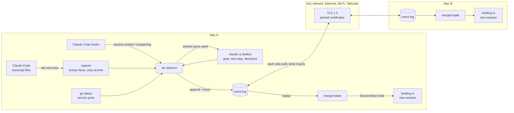
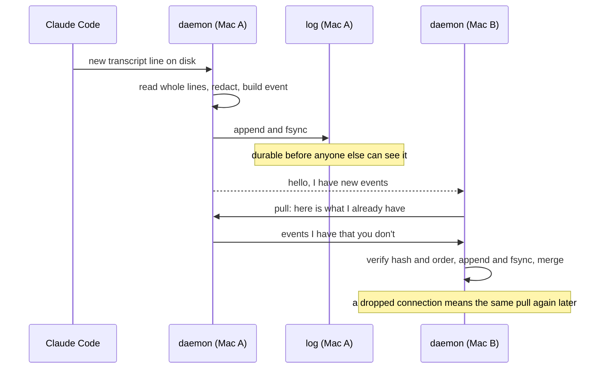
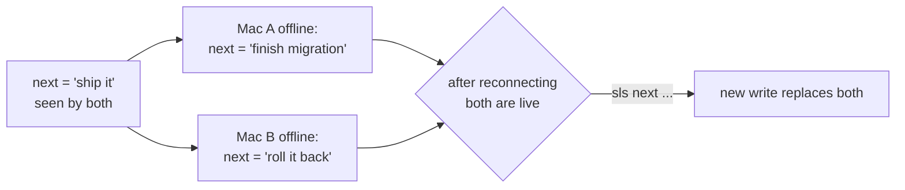
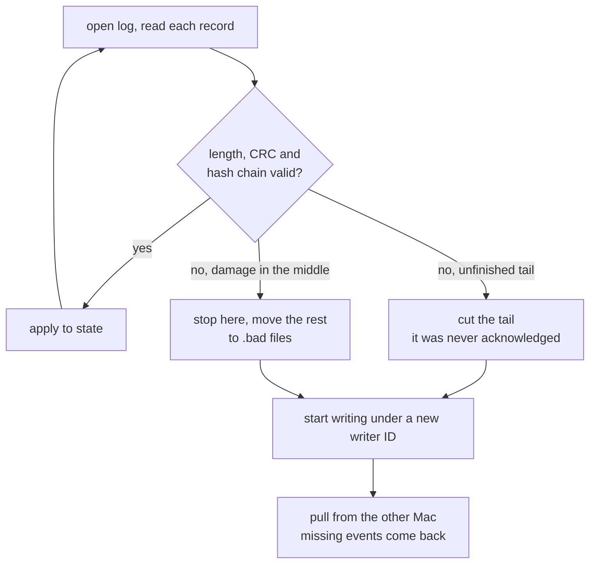

# How it works

The short version: every Mac keeps its own append-only log of what happened. Macs copy log entries they're missing from each other. Current state is calculated from the log, and the calculation gives the same answer no matter what order entries arrive in.

## The whole system

## What happens to one change

## How a conflict is kept instead of lost

Every write lists the writes it replaces. A write nobody has replaced is still live. If two Macs change the same thing while apart, neither one replaced the other, so both stay live and the next session is told about it.

This doesn't depend on clocks at all, which is why a Mac with the wrong date can't win or lose a conflict.

## Recovering after a crash

## Decisions

| Decision | Why | What it costs |
|---|---|---|
| Append-only log with fsync before anything is visible | A peer can never hold an event the source could lose in a crash | About 3.5 ms per commit on an M5 Pro. Writes are batched per minute per session, so it doesn't matter |
| Wrote the log by hand instead of using SQLite | The whole point is being able to test exactly what survives a power cut, and it keeps the project at zero dependencies | More code to get right, which is what the fake disk and the simulator are for |
| New writer ID every time a process starts writing | A restored Time Machine backup or a cloned disk can't reuse old sequence numbers, so that whole class of split-history bugs can't happen | The version vector grows by one entry per daemon run |
| Multi-value registers instead of last-write-wins | Two people's next steps are both information. Throwing one away based on a clock is how work gets lost | Someone sometimes has to pick one |
| Pull only replication | Retrying is always safe because a retry is the same question again. There are no acks to lose | A short delay, softened by a hello that tells the other side to pull now |
| Pinned TLS certificates instead of trusting the network | Works the same over any network and doesn't depend on Tailscale being set up | Pairing is one copy and paste each way |
| Dial every address at once | Going from Ethernet to home Wi-Fi needs no config change, the address that works wins | A few wasted connection attempts |
| Tail transcript files instead of relying on hooks | Hooks don't run when the battery dies. Files are already on disk | Depends on a transcript format that isn't a public API, so `sls doctor` watches for it breaking |
| Interrupted is calculated when read | A session that died suddenly can't write "I died" | Nothing really |
| Facts need no AI, summaries are optional | Files, commands and git state work offline and for free. If the summary call fails, nothing important is missing | Goal and next step wait until a session goes quiet |
| Briefings are labeled as background | Old transcripts can contain anything, so they must not read as instructions | A sentence of context in each session |
| Single Go binary, standard library only | Nothing to install on the second Mac | Had to write a few small things by hand |

## Package map

| Package | Job |
|---|---|
| `vfs` | Disk interface, plus the fake disk that loses unsynced data like a power cut |
| `wal` | Segmented append-only log and crash recovery |
| `event` | Event format and tamper-evident hash chain |
| `hlc` | Hybrid logical clock for display ordering |
| `state` | The merge logic. Order independent and idempotent |
| `store` | Log + state + per-writer index |
| `replica` | Pull protocol and the TLS transport |
| `sim` | Deterministic simulator: crashes, bad links, restored backups, bit rot |
| `capture` | Transcript tailing, session facts, secret redaction |
| `project` | Same project ID across Macs, git and folder status |
| `brief` | Turns state into the text a new session reads |
| `summary` | Calls `claude -p` safely |
| `daemon` | Runs it all |
| `e2e` | Real daemons on one machine, including `kill -9` |
